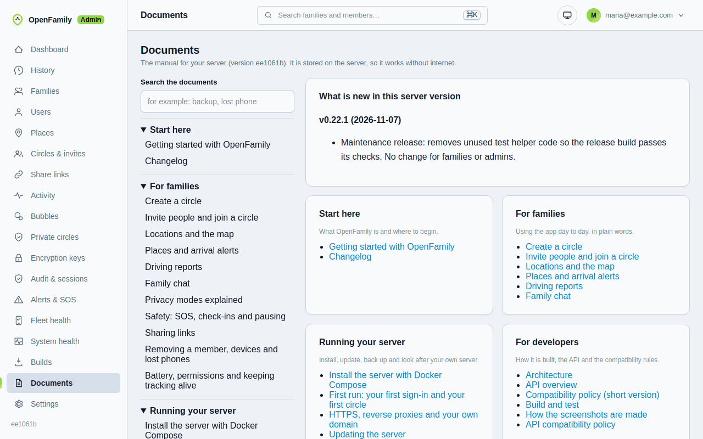

# Orbitly documentation

Orbitly is a private, self-hosted way for a circle of people (family, friends, a team) to share locations, get arrival alerts, chat and send an SOS; this is the manual.

The manual also ships inside every server: sign in to the admin web and open **Documents**. It works without internet, has search (press `/`),
and shows what is new in your server version.

## Start here

- **[Quick start (5 minutes)](quick-start.md)**: install, sign in, approve the server, create a circle, invite, install the app
- [Getting started](user/getting-started.md): what Orbitly is and the three roles
- **[Concepts](concepts.md)**: Normal, Private and server processing in plain words, with a picture
- [FAQ](faq.md) and [Glossary](glossary.md)
- Something wrong? **[Troubleshooting](troubleshooting/index.md)**

## I use the app

[Create a circle](user/create-a-circle.md) and [invite people](user/invite-and-join.md), then:

- [Locations and the map](user/locations-and-map.md), [Places](user/places.md)
- [Driving reports](user/driving-reports.md), [Family chat](user/chat.md)
- [Privacy modes explained](user/privacy-modes.md)
- [Safety: SOS, check-ins, pausing](user/safety-and-check-ins.md), [Sharing links](user/sharing-links.md)
- [Removing a member, lost phone](user/members-and-devices.md), [Battery and permissions](user/battery-and-permissions.md)

## I run the server

- [Install with Docker Compose](admin/install.md), then [First run](admin/first-run.md) and [Server setup](server-setup.md) (approve the server once)
- [HTTPS and your own domain](admin/https-and-domain.md) ([DNS details](custom-domain.md))
- [Updates](admin/updates.md) and [App versions](admin/app-versions.md); [What is new](CHANGELOG.md)
- [Backups and restore](admin/backups.md) ([in depth](backup-restore.md))
- [Notifications and SMS](admin/notifications.md), [Integrations](admin/integrations.md)
- [Deployment profile: home or cloud](admin/deployment-profile.md)
- [Hardening checklist](self-hosting.md), [Operator privacy controls](privacy-controls.md), [Android install and updates](android-install-and-updates.md)
- [Troubleshooting](troubleshooting/index.md), [Admin checklist](admin/troubleshooting.md), [Nobody shows on the map](troubleshooting/no-locations.md)

## Feature reference (technical)

[Chat](chat.md), [Safety](safety.md), [Check-ins](checkin-sharing.md),
[Share links](share-links.md), [Geofences](geofencing.md), [Bubbles](bubbles.md),
[Driving](driving.md), [Driving sensors](driving-sensors.md), [Push](push.md),
[SMS](sms.md), [Passkeys](passkeys.md), [Maps](maps.md), [Reliability](reliability.md),
[Home Assistant](integrations/home-assistant.md), [Dawarich](design/DAWARICH.md).

## I build Orbitly

[Architecture](developers/architecture.md), [API](developers/api.md),
[Compatibility](developers/compatibility.md), [Build and test](developers/build.md),
[Screenshots](developers/screenshots.md), [Naming](developers/naming.md),
[Design decisions](design/PRIVACY_PROCESSING.md), [Licences](THIRD_PARTY_LICENSES.md).

## About

[Credits and license](about/credits-and-license.md): Orbitly is a substantially extended fork of
OpenFamily by wheresfrank and contributors (AGPL-3.0), and where to get the source. It was published as
OpenFamily before the rename. Apps for Wear OS and Apple Watch are coming.
