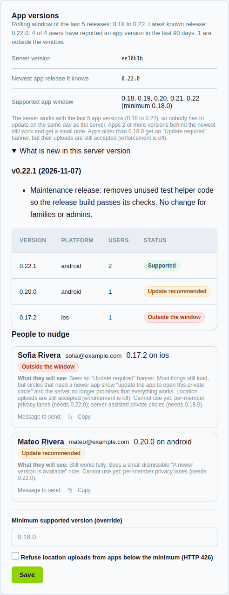

# App versions and what your server supports

People update phones slowly. The server therefore keeps working for the **last
five minor versions** of the app (for example 0.18 to 0.22). Open the admin web
**Settings > Updates & about** to see:

- The **server version** and what is new in it (also in **Documents**).
- The **supported window** and the oldest version that is fully supported.
- Which app versions are in use, per person and per platform.
- For anyone outside the window: what that person will experience, and a ready
  message you can copy and send.

## What people see

| Their app is | They experience |
| --- | --- |
| Inside the window | Everything works. |
| 2 or more versions behind the newest | Works. A small dismissible "newer version available" note. |
| Older than the window | An "Update required" banner; circles needing newer features say "update the app to open this private circle". If you switch on enforcement, location uploads from that app are refused until it updates. |
| Not reporting a version | Old app or script; never blocked. |

## Settings

- **Minimum supported version (override)** lets you widen or narrow the window.
- **Refuse location uploads from apps below the minimum** is off by default.
  Turn it on only if you must retire an old version.

The same facts are available to the app at `GET /compat`. The policy in full:
[API compatibility](../api-compat.md).
