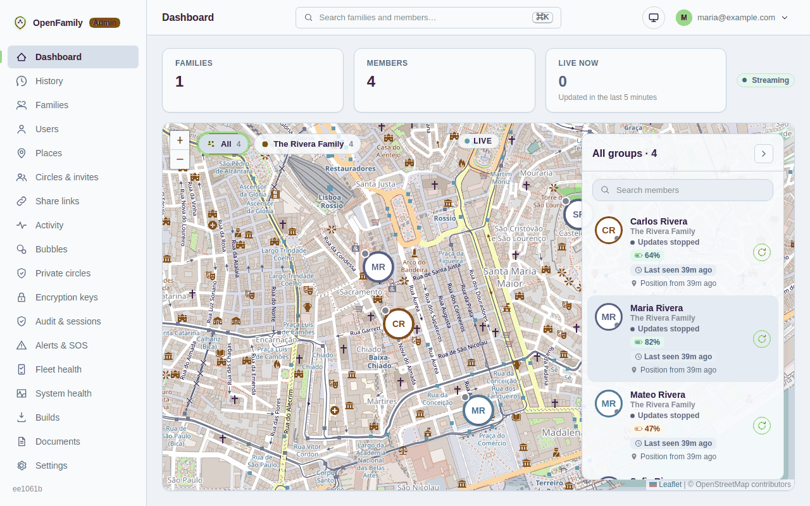
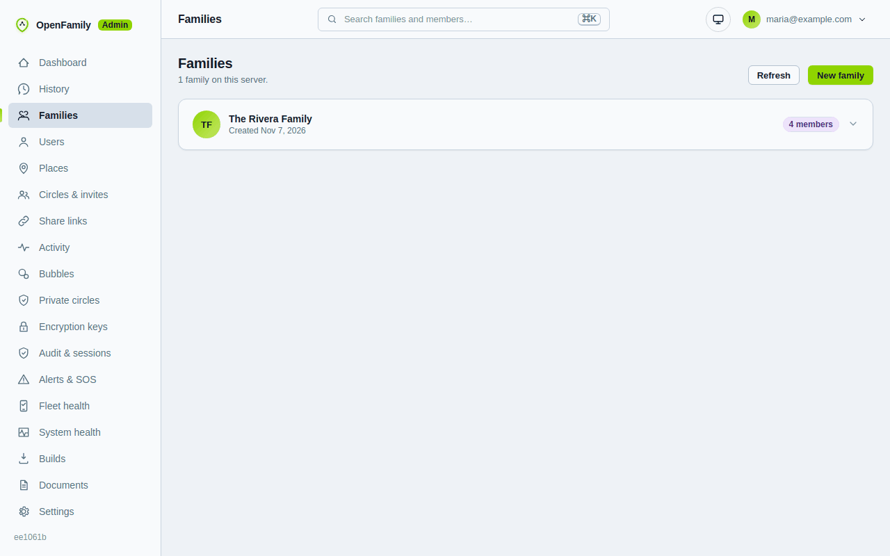

# First run: your first sign-in and your first circle

Your first sign-in to the admin web: registration is closed, turn on two-step sign-in, create the first circle and check the settings that matter.

1. Open the admin web and sign in. Because you set an admin email during setup,
   **open registration is closed**: new people need an invite code.

2. **Turn on two-step sign-in** for your admin account in the app (Settings,
   Security). You can require this for every admin with `REQUIRE_ADMIN_MFA=true`.
3. In the app: create your account with the same email. Your phone shows **"Your server wants to join"**:
   compare the short code with the admin web (Settings > Server setup) and tap approve once
   ([Server setup](../server-setup.md)). Then [create a circle](../user/create-a-circle.md): **Private, with
   your server** is preselected, so the circle is end-to-end encrypted and everyone who joins is on the server
   by default and can opt out ([Server processing](../user/server-processing.md)). Then
   [invite your family](../user/invite-and-join.md).
4. In the admin web look at **Families**, **Users** and **System**:

5. Open **Settings** and check:
   - **Deployment profile**: home or cloud ([explained here](deployment-profile.md)).
   - **Backups**: see [Backups](backups.md).
   - **App versions**: see [App versions](app-versions.md).
6. Give your family the install instructions: [Installing on Android](../android-install-and-updates.md).

## What a server admin can and cannot see

By default a server admin sees accounts, circles, devices and audit logs, but
**not where anyone is** (`ADMIN_LOCATION_ACCESS=false`). If you turn it on,
every look is written to an audit log the circle can read. In a Private circle the
server can read only the members who use server processing (the default; each member can opt out). See
[Privacy modes explained](../user/privacy-modes.md) and
[Operator privacy controls](../privacy-controls.md).

## The admin web at a glance

| Page | Use it to |
| --- | --- |
| Dashboard | Live map of everyone you are allowed to see |
| Families, Users | Accounts, roles, invites, password reset codes |
| Places, Circles, Sharing | Saved places, circle settings, share links |
| Activity, Alerts, Audit | What happened, SOS and check-ins, who looked at what |
| Fleet | Which phones are reporting and which have gone silent |
| System | Version, database, warnings, last backup |
| Builds | Download the Android app from your own server |
| Documents | These guides, offline, plus what is new in your server version |
| Settings | Map style, SMS, domain, integrations, app versions |
