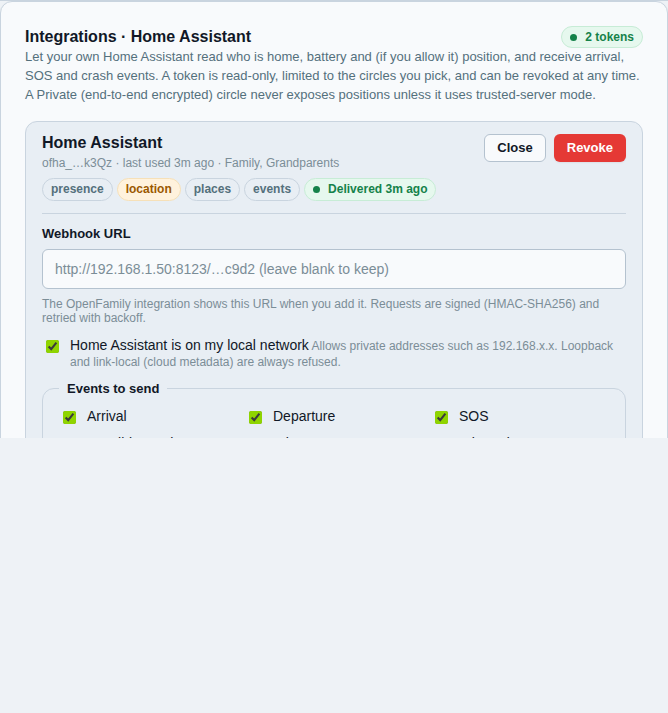

# Integrations: Home Assistant and Dawarich

Connect Orbitly to Home Assistant (who is home, arrival automations) or Dawarich (a location history service you run) using a token you control.

## Home Assistant

Show who is home, trigger automations when someone arrives, or light a lamp
when a child leaves school.

1. In the app (Settings, Integrations) create a **Home Assistant token**. It is
   read-only, scoped to the circles you choose, and shown once.
2. Install the Orbitly custom component in Home Assistant and paste the
   server address and token.
3. Optionally enable signed webhooks for events.

Admins can see tokens and revoke them on the admin web. Full guide with
examples: [Home Assistant](../integrations/home-assistant.md).

## Dawarich

[Dawarich](https://dawarich.app) is a self-hosted location history viewer.
Orbitly can push points to it, one way. Configure it under **Settings >
Integrations**: address, API key, per-member mapping. Deleting points in Orbitly
does not delete them in Dawarich. In Private circles the Dawarich bridge is an
approved device that members must allow. Design notes: [Dawarich](../design/DAWARICH.md).

If Dawarich cannot be reached or refuses the key, the card turns orange ("Retrying")
and says what failed, how many times in a row, when the next try is and when
something last arrived. Orbitly waits longer after each failure (2, 4, 8, 16, 32
minutes, then an hour) instead of asking every minute, and writes the problem to
the server log once, not every minute. Fix the cause, or press **Sync now** to try
at once; saving the settings also starts over. Nothing is lost while it waits: the
points are sent later, oldest first.

## Privacy of integrations

Both only receive what the circle's [privacy mode](../user/privacy-modes.md)
allows. A person who keeps their data phone-only is not sent to either.
