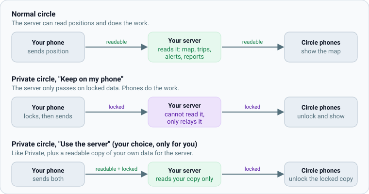

# Concepts: Normal, Private and server processing

The three ways a circle can handle your location, in plain words: who can read it, who does the work, and what that costs.

Everything in Orbitly comes down to one question: **who can read a person's location, and who does the work of turning it into
a map, trips and alerts?** There are two choices to make, and they are easy to mix up, so here they are one at a time.

## Choice 1: the circle's mode (the circle admin chooses)

| Mode | In one sentence | Can the server read positions? |
| --- | --- | --- |
| **Normal** (the default for new circles) | Phones send positions to your server, which does all the work. | **Yes.** |
| **Private** | Phones lock each position with a key the server never has, and only the other phones in the circle unlock it. | **No.** It relays locked data. |

**Normal** is the simplest and gives you everything: the live map, history, weekly driving reports, arrival and departure alerts,
the admin web's view, and integrations such as Home Assistant. The person who runs the server can in principle read the data, which is why
you want to run it yourself or trust whoever does. Whether a server admin may look at members on the admin map is a separate switch,
**off by default**, and every look is written to a log the circle can read.

**Private** is for circles where nobody, not even the person running the server, should be able to read where people are. The price is
that the server cannot compute anything from your data, so phones do the work.

## Choice 2: who does the work in a Private circle (each person chooses for themselves)

Inside a Private circle, every member answers one question on their own phone, once:

- **Use the server (recommended)**: your phone also gives the server a readable copy of **your** data, so reports, history and the
  admin web work for you. The rest of the circle still shares locked data with each other. Nobody can choose this for you.
- **Keep on my phone**: your data stays locked. Reports are off unless you turn on phone reports, which use more battery. You can change your mind at any time.

This is called **server processing**. It is the default direction of Orbitly (a new circle is Normal and the setup suggests the server),
but it is never switched on behind your back.

## What it costs

| | Normal | Private, Use the server | Private, Keep on my phone |
| --- | --- | --- | --- |
| Server can read your position | Yes | Yes, your copy only | No |
| Live map, history | Yes | Yes | Yes (phone to phone) |
| Driving reports and weekly summaries | Yes | Yes | Only with phone reports (more battery) |
| Admin web map | If admin access is on | If admin access is on | No |
| Battery use | Lowest | Low | Higher |

## Offline behaviour

Phones keep working without a connection to the server. Position updates wait on the phone and are sent when the connection returns,
nothing is dropped, and each person's last known position is remembered on the phone, so a cold start never shows a blank map.
Chat drafts stay and are retried without sending twice. The documents you are reading are stored on the server, so
they open without internet. Map tiles come from a map provider and need internet unless you host your own (see [Self-hosting](self-hosting.md#map-tiles)).

## Chat

Chat in a **Private** circle is end-to-end encrypted: messages, edits, deletes and photos are locked on the sender's phone and opened on the
members' phones. The server only relays them and never reads them, even for people who chose **Use the server**. Chat in a **Normal** circle is stored readable on the
server, like locations. Old messages from before a circle turned Private stay readable until an admin deletes them. See [Family chat](user/chat.md).

## What no choice hides

- That you use the app and roughly when (the server sees that something was uploaded, its size and time).
- Anything copied before you changed your mind, and old backups.
- Other members: anyone in the circle can read what the circle shares. Only add people you trust.
- Share links work for anyone who has the link until they expire ([Sharing links](user/sharing-links.md)).

## Where to read more

- [Privacy modes explained](user/privacy-modes.md): the same ideas with screenshots and "how to choose"
- [Server setup](server-setup.md): add your server, approve it once
- [Deployment profile: home or cloud](admin/deployment-profile.md): what to do on a rented server
- [Privacy processing design](design/PRIVACY_PROCESSING.md): the technical decision record
