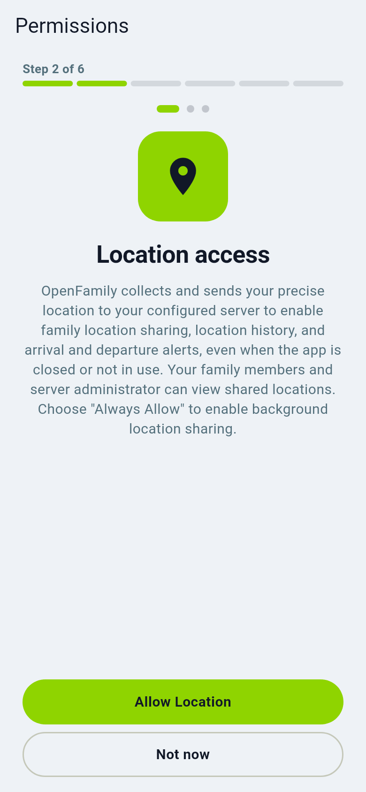
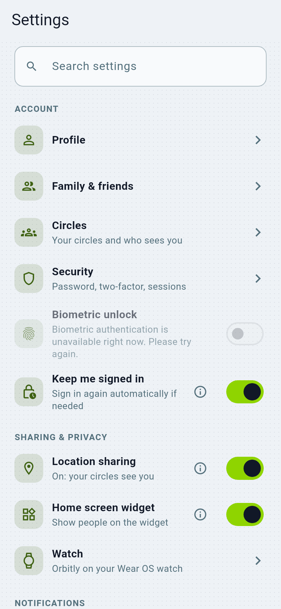

# Battery, permissions and keeping tracking alive

For the map to stay current, Android and iOS must let Orbitly run in the
background.

1. Allow location **"All the time"** (not "While using").
2. Allow notifications and, on Android, "Physical activity" for driving.
3. Android: set battery for Orbitly to **Unrestricted** or **Don't optimize**. The
   **Open battery settings** buttons in Orbitly go straight there (a one-tap
   question about Orbitly itself, or Orbitly's own app page). By hand:
   **Settings > Apps > Orbitly > Battery > Unrestricted**.
   Samsung, Xiaomi and Huawei phones have an extra "sleeping apps" list; remove
   Orbitly from it. On Samsung, **Never sleeping apps** may not offer Orbitly
   when you search or scroll its list; the **Unrestricted** choice above does the
   same job, so you do not need that list.
4. Install ntfy (or accept the app's built-in channel) so alerts arrive when the
   app is closed: [Notifications](../admin/notifications.md).

## Tracking stopped while the app was closed

Android can end Orbitly's background service on its own (low memory, a battery or "sleeping apps" rule of the phone
maker, a frozen app). Orbitly cannot prevent that. What it does since 0.26.33: when you open the app again and sharing
is on and "Allow all the time" is granted, it starts the background service again if it is not running, and it keeps a
record of what happened so the next time can be explained.

What to check, in this order:

1. Location is **Allow all the time** (Settings > Apps > Orbitly > Permissions > Location).
2. Battery for Orbitly is **Unrestricted** (Settings > Apps > Orbitly > Battery). On Samsung also remove Orbitly from
   **Sleeping apps** and **Deep sleeping apps** (Settings > Battery > Background usage limits); **Never sleeping apps**
   may not offer Orbitly, and **Unrestricted** does the same job.
3. Sharing is on in Orbitly and the circle is not paused.
4. Open **Settings, Advanced, Diagnostics**, tap **Copy diagnostic report** and look at these lines at the end:
   - **Recent process exits**: Android's own record of why Orbitly's process ended (for example `FREEZER`,
     `LOW_MEMORY`, `USER_REQUESTED`, `CRASH`), with the time in your local time and in UTC. Compare the time with the
     moment the map stopped updating. This needs Android 11 or newer.
   - **standby_bucket** and **battery_optimisation_ignored**: `RESTRICTED` or `RARE`, or `no`, means Android limits
     background work for Orbitly.
   - **Background pipeline**: the last upload that worked, the last identity or encryption error, and counts per hour
     (received, dropped, parked, posted, credential failures, seal errors, heartbeats).
   - **Tracking journal**: service created and destroyed (with whether the stop was requested), app paused and resumed,
     the service restarted on resume, permission changes, heartbeats that could not be delivered because the service
     was gone, and `background_drain` lines when positions that waited for an unreadable key were sealed later.

The report holds no locations, tokens or keys. When you ask for help, paste it whole.

## What costs battery

- Normal use is light.
- **Private circles** and **driving detection** do their calculations on the
  phone. You may see higher battery and CPU use while driving or after a long
  offline period. The app warns you before you turn this on.
- Poor signal, and a "live boost" while someone watches you, use more.

## Self-test

**Settings, Advanced, Diagnostics** (self-test) checks permissions, battery exemptions
and connectivity, and the server can warn the circle when a phone goes silent.
See [Reliability](../reliability.md).

