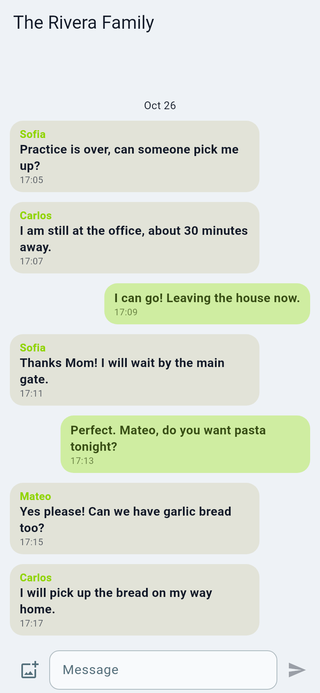
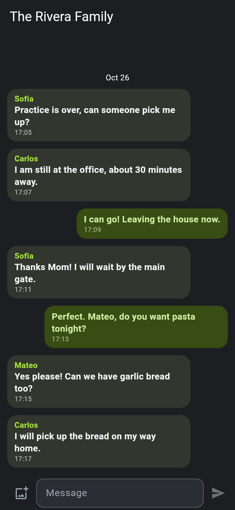

# Family chat

Every circle has a chat for its members only, end-to-end encrypted in Private circles.

- Open the **Circle** tab and tap **Family chat**. A badge counts unread
  messages.
- Type a message and send. If you are offline the draft stays and is retried
  without sending twice.
- **Long-press** your own message to edit or delete it. Circle admins can
  delete any message.
- You can send a photo; location data inside it is removed.
- Notifications say only "New message in <circle>", not the text, unless your
  server admin enabled verbose notifications.

Who can read the chat? In a **Private** circle chat is end-to-end encrypted: messages, edits, deletes
and photos are locked on your phone and opened on the other members' phones, and the server only relays them. In a **Normal**
circle chat is stored readable on the server, like locations. Messages written before a circle turned Private stay readable until a circle admin
deletes them. Choosing between modes: [Concepts](../concepts.md). Technical notes: [Chat](../chat.md) and
[Encrypted chat design](../design/E2EE_CHAT.md).
