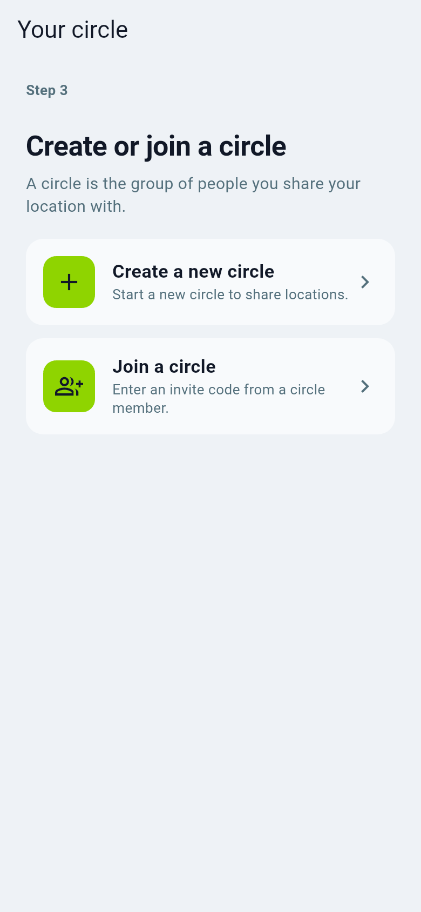
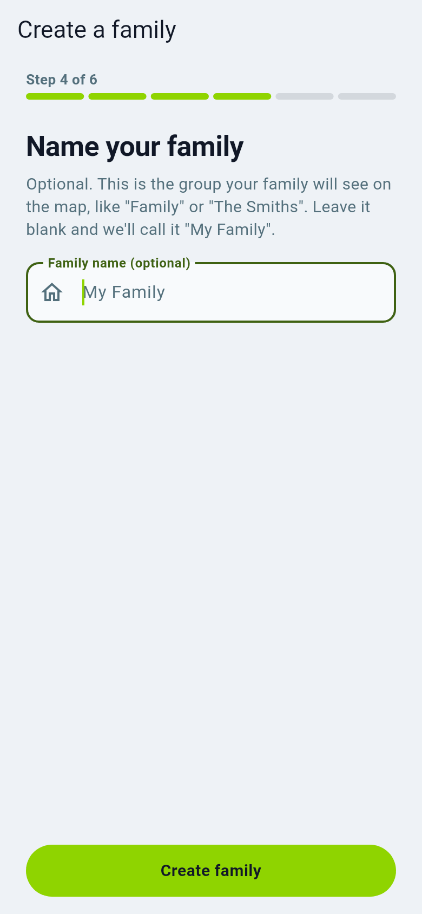
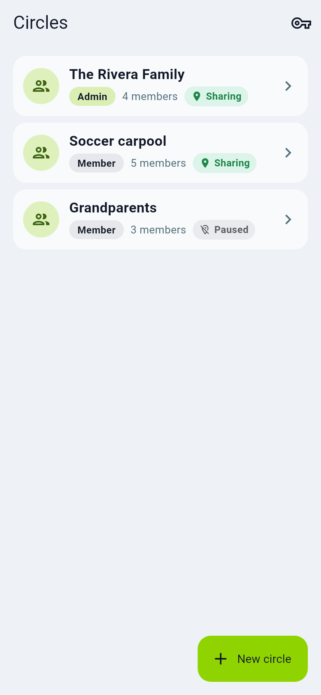
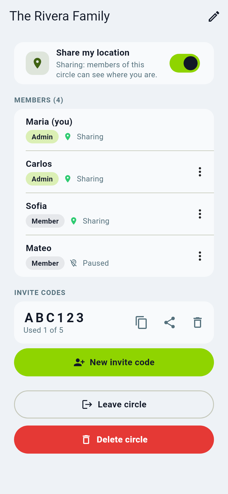

# Create a circle

A **circle** is a group of people who share their location with each other:
your family, friends, a carpool, the grandparents. You can be in several circles and
choose in each one whether you share.

1. After signing in choose **Create a new family**.
2. Give it a name, for example "The Rivera Family". The name is only for
   your people.

3. Tap **Create family**. You are the circle admin.
4. Next the app offers to **invite your family**. See [Invite and join](invite-and-join.md).

## Circle details

Open a circle to see its people, who is an admin, your sharing switch and the
invite code.

- **Share my location** turns your sharing on or off for this circle only.
- Admins can rename the circle, change roles, remove people and set the
  circle's [privacy mode](privacy-modes.md).
- **Leave** removes you from the circle; **Delete** (admins) removes the circle
  for everyone.

Choosing a privacy mode when you create a circle matters: **Normal** circles
let the server show locations on the admin map and compute driving reports;
**Private** circles keep positions sealed between phones. Read
[Privacy modes explained](privacy-modes.md) before you decide.
