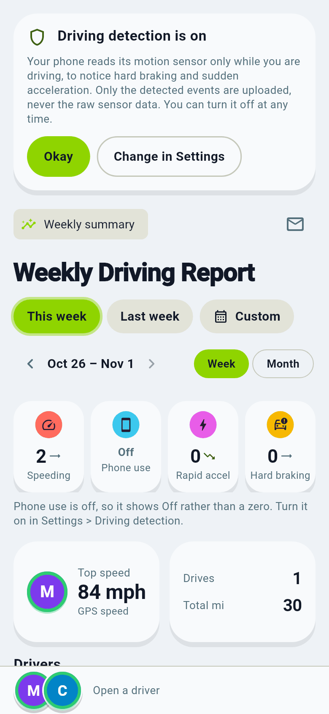

# Driving reports

Orbitly shows how the people in your circle drive each week or month: drives, distance, top speed, and events such as speeding, hard braking, rapid acceleration and (optional, per person) phone use.

## What the Driving tab shows

- **Header cards:** the fastest speed (and who set it), the total number of drives and the total distance for the period.
- **Event chips:** speeding, hard braking, rapid acceleration and phone use, each with how it compares to the period before. Tap one to see who it was and what the numbers mean.
- **Week and month:** use the arrows, "This week" and "Last week", or pick any day. The daily chart shows how much was driven on each day; tap a bar to see just that day's drives.
- **Drivers:** one card per person with their drives, distance, top speed and event counts. Tap a card for that person's full trip list, with maps and details for each drive.
- **Recent drives:** the latest drives of the whole circle. Tap one to see the route and the events on it.
- **Driving now:** anyone who is driving at this moment is shown at the top.

## Who is counted

- Reports need **driving detection** switched on by each driver. Nobody can switch it on for someone else.
- Phone use is shown as **Off** (not zero) for people who have not turned it on.
- In a **Normal** circle the server works the report out from everyone's locations.
- In a **Private** circle it depends on each person's own choice under **Settings > Where my data is processed**:
  - If you chose **the server**, the server works out your drives, exactly as in a Normal circle. You get the full report with maps.
  - If you chose **your own phone**, your phone works out your drives and shares only the results with the circle. They count in the header cards, the chips, the chart and the drive list like everyone else's. Place names and route maps stay on your phone, so those drives show a short note instead of a map. Reports on your phone use a little more battery and can arrive a bit later.
  - If you have not switched anything on yet, your card says so and offers two buttons: **Use the server**, or **Compute reports on this phone**.
- If someone's phone has not shared anything yet (it may be switched off), their card says "Waiting for ..." instead of showing zeros.

See [Privacy modes explained](privacy-modes.md).

## When you are offline

Orbitly keeps the last report it loaded. Without a connection you see that report with a note such as "You are offline. Showing the report saved 3 h ago." Pull down to try again once you are back online.

Details and thresholds for administrators: [Driving events](../driving.md) and [Driving sensors](../driving-sensors.md).
