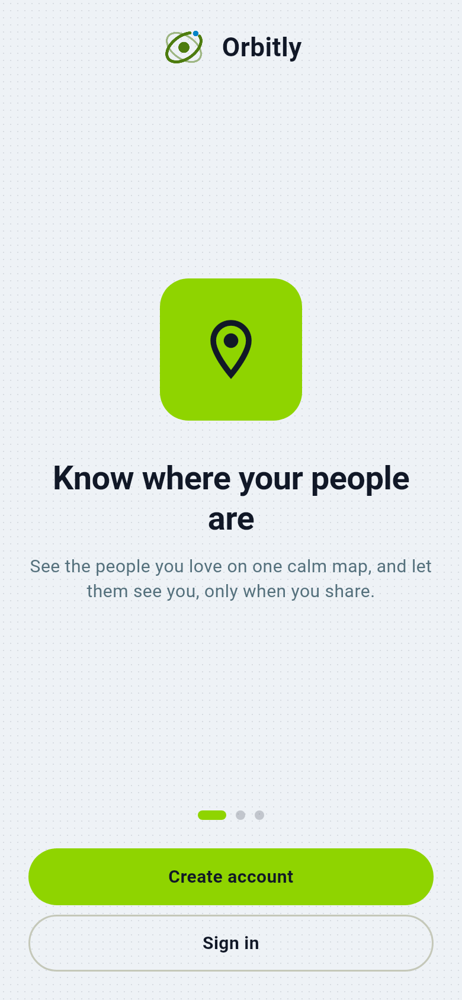

# Getting started with Orbitly

Orbitly is a private way for your people (family, friends, a team) to see where
everyone is, get arrival and departure alerts, chat, and send an SOS. It runs
on a small server that your circle (or the person who looks after your tech)
controls, so your locations are not sold or stored by a company. Orbitly was
published as OpenFamily before the rename.

## The three roles

| Who | What they do |
| --- | --- |
| **Family member** | Installs the app, joins a circle, shares their location. |
| **Circle admin** | Creates a circle (for example "The Rivera Family"), invites people, sets places and privacy rules for that circle. |
| **Server admin** | Installs and looks after the server. Often the same person as the circle admin. See [Running your server](../admin/install.md). |

## Your first ten minutes

1. **Install the app** on your phone. On Android your server admin gives you
   a link; see [Installing on Android](../android-install-and-updates.md).
2. **Enter the server address** your admin gave you (for example
   `https://family.example.com`) and tap Connect.
3. **Create an account**, or sign in. If the server asks for an invite code,
   use the one you were sent ([Invite and join](invite-and-join.md)).
4. **Create a circle** or join one: [Create a circle](create-a-circle.md).
5. **Allow location "all the time"** and notifications, and switch off battery
   saving for Orbitly: [Battery and permissions](battery-and-permissions.md).
6. Open the **map**: [Locations and the map](locations-and-map.md).

## Where to go next

- [Places and arrival alerts](places.md)
- [Driving reports](driving-reports.md)
- [Family chat](chat.md)
- [Privacy modes explained](privacy-modes.md): what the server can and cannot see
- [Safety: SOS and check-ins](safety-and-check-ins.md)
- [Removing a person, a lost phone](members-and-devices.md)
- Something wrong? [Troubleshooting](../admin/troubleshooting.md)

All the screenshots in these guides are drawn from the app's own screens with
made-up data (the "Rivera Family"). See [How screenshots are made](../developers/screenshots.md).
