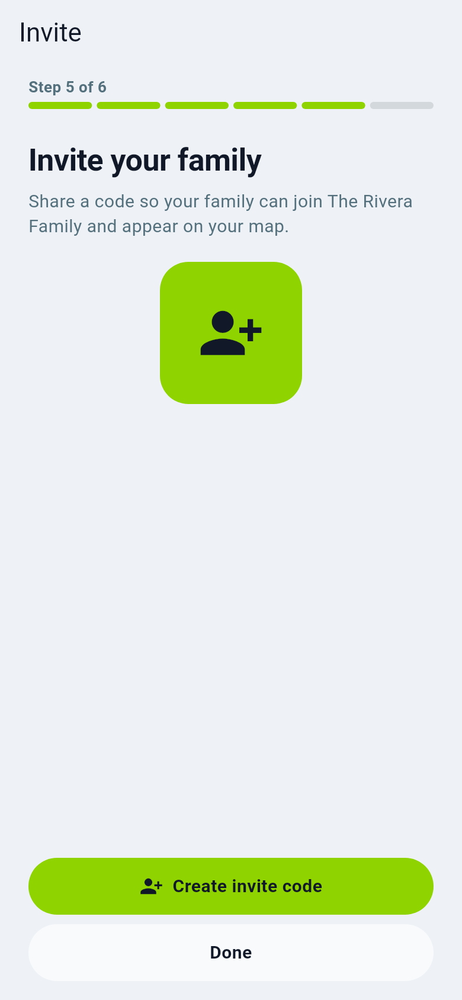

# Invite people and join a circle

How a circle admin invites family or friends with a code or link, and how they join from the app.

## Inviting (circle admins)

1. Open the circle and tap **Invite**.
2. Tap **Create invite code**. Share the code or the link by message.

Codes expire and can be revoked. A server admin can also see and revoke open
invites on the admin web **Groups** page. Never post an invite code in a
public place.

## Joining

1. Install the app and enter your server address.
2. Choose **Join a circle** and type the code, or just open the invite link on
   your phone.
3. **Before you join** the app shows how the circle handles privacy, so you
   know what you are agreeing to. Read it; see [Privacy modes explained](privacy-modes.md).
4. Allow location access ([Battery and permissions](battery-and-permissions.md)).

### Joining from a web page (no app needed first)

Open `https://<your server>/join`, type the code, then enter your name, email and a password. That creates your account and puts you in the circle in one step. Then install the app and sign in with the same email and password to share your location. An invite link (`/join/<code>`) goes straight to the form. A Private circle still needs the app to finish setting up its keys.

If that email already has an account, nothing changes (the page looks the same on purpose, so it does not reveal which emails exist): sign in with the existing password.

### Server admins: add an account to a circle

On the admin web **Circles** page, open a circle, choose an account under **Add an account…** and tap **Add**. Use this for an account you created yourself. Typing a code on the Groups page only ever joins the account you are signed in with.

If the code is refused: check it was typed exactly, that it has not expired,
and that you are on the correct server. Ask the admin for a fresh code.
