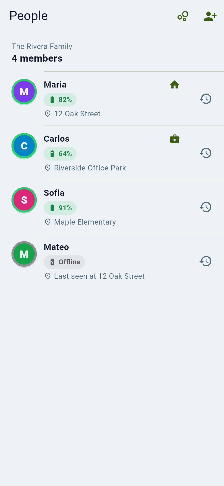
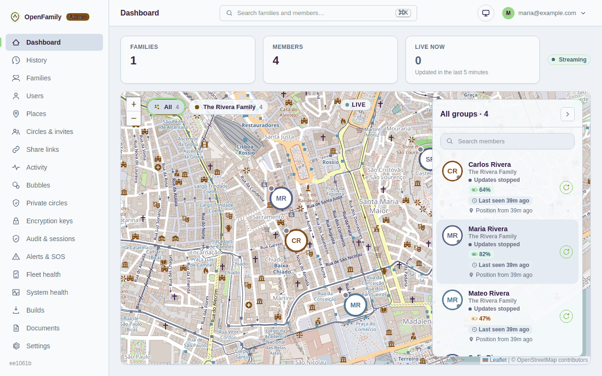

# Locations and the map

The map shows each person in your circles with a photo or initial, their
battery level, and how fresh the position is.

## Reading the map

- A **bubble** is a person. Tap it for their card: address, battery, speed and
  when the position was last updated.
- **Grey or "last seen"** means the phone has not reported for a while. That
  is usually battery saving, a switched-off phone or no signal, not a problem
  with you. See [Nobody shows on the map](../admin/troubleshooting.md#nobody-shows-on-the-map).
- **Paused** means the person chose to stop sharing for a while. They are not
  hidden by mistake. See [Safety and check-ins](safety-and-check-ins.md).
- Your circles, people and their addresses also appear as a list:

## On the web

Your server's admin web page has the same map and history for people who
prefer a computer. A *server admin* does **not** see anyone's position unless
the server was set up to allow it; see [Privacy modes explained](privacy-modes.md).

## History

Each person's route is stored for a limited time (90 days by default) and each
person can choose a shorter time or erase their own history in the app.
