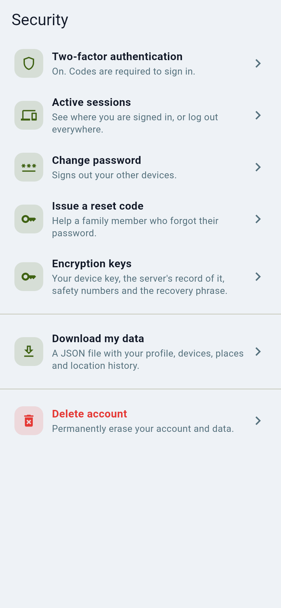
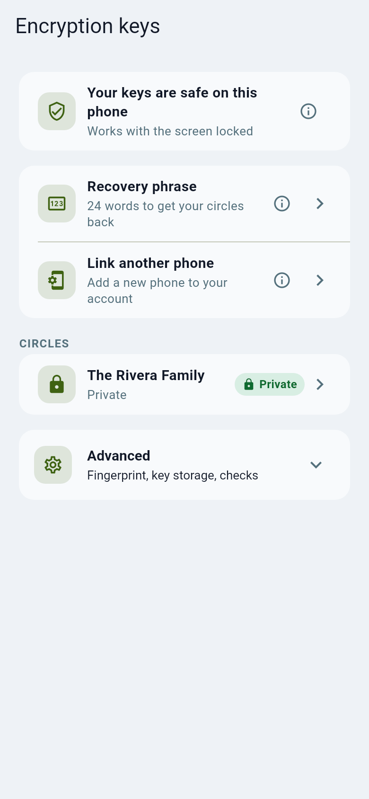

# Removing a member, devices and lost phones

Remove someone from a circle, sign out a lost or replaced phone, and what each person can do with their own devices.

## Remove a person from a circle

Circle admins: open the circle, tap the person, choose **Remove**. They lose the
map, chat and photos immediately. In a **Private** circle the circle key is
renewed so a removed person's phone cannot read anything new.

## Someone left or changed phone

Ask them to sign in on the new phone. For a Private circle the new phone must
be approved by one of their other devices, or recovered with their recovery key.
Remove the old phone from **Settings, Security, Active sessions**.
If they had neither (they chose **Set this phone up again**), a circle admin
approves the new phone in **Encryption keys**, after comparing safety numbers.

## Encryption keys

**Settings, Security, Encryption keys** shows, at the top, whether this phone's keys are safe, then the two
everyday actions: **Recovery phrase** (24 words to get your circles back) and **Link another phone**. Below
that is one row per circle with its status (Private or Normal); tap a circle to see its members, compare
safety numbers and approve a new phone. The technical details (fingerprint, where the key is stored, a check
of the server record) are under **Advanced**.

## Settings at a glance

**Settings** has six groups. Every row has a title and at most one short line; tap the (i) for the long explanation.

| Group | What is in it |
| --- | --- |
| Account | Profile, Theme, Keep me signed in, Log out |
| Circle | Circles, Family & friends, Location sharing |
| Notifications | Push notifications on or off, Notification settings (places, drives, quiet hours, names in notifications) |
| Privacy and security | Security (password, two-factor, sessions, data export), Biometric unlock and lock delay, Server processing, Privacy policy |
| Devices | Link another phone, Watch, Home screen widget, Driving detection, Background updates |
| About | About Orbitly, Replay walkthrough, the version (seven quick taps open the hidden Performance screen) |

**Advanced** (last, folded) holds what most people never need: Diagnostics, Server address, Map style, Accent colour,
Distance and speed units, Delete account. The search box at the top finds every setting, Advanced ones included; type
several words to narrow it down.

On a narrow screen (such as a folded phone's cover display) or at large text the little icons in front of the rows
are left out so the words fit; on wide screens the settings sit in a centred column.

### Keep me signed in

With **Keep me signed in** on, Orbitly saves the password you sign in with in the Android Keystore or iPhone Keychain
of this phone. If the server later ends your sign-in on this phone and nothing else can renew it, Orbitly signs in
again with that password without asking you. It does **not** work when your account uses two-factor sign-in: Orbitly
cannot type the code for you, so nothing is saved and you are asked to sign in again. The row says which case you
are in: **On: this phone signs back in**, **On: saved at your next sign-in** (turning it on later saves nothing until
you next sign in with your password), **Not possible with two-factor**, or **Off**. Turning it off, changing your
password or logging out deletes the saved password.

## Link another phone

Use this to add a second phone, or a replacement phone, to your account so your Private circles open on it.
Keep both phones in front of you, signed in to the same account, and open **Settings, Devices, Link another
phone** (or **Encryption keys, Link another phone**) on each. The screen first asks **Which phone is this?** and then shows one step at a time:

1. On the new phone choose **This is the new phone** and tap **Make a code**. Send the code to your other
   phone with **Share** or **Copy** (a message to yourself works), or show it as a **QR code** and read it with
   the other phone's camera app. The new phone also shows a short **check code**.
2. On the phone you already use choose **This is the phone I already use**, paste the code and tap
   **Continue**. Approve with **They match: approve** only if both phones show the same check code; if they
   differ, tap **They are different** and nothing is approved. The long check number is under **Details**.
3. Send the answer it shows back to the new phone, paste it under **Then paste the answer** and tap
   **Finish linking**. The new phone says **This phone is linked**.

No other phone? Restore with your recovery phrase instead. Without either, **No other phone?** on the same
screen offers **Reset my keys** (see [If you reset your encryption keys](server-processing.md#if-you-reset-your-encryption-keys)).

## Owner approval (when you are the only admin)

If you created a Private circle, are its only admin and set your own phone up
again, nobody else can approve it. The circle screen in **Encryption keys**
then offers two ways out: make another member an admin (**Members**), or turn
on **Owner approval** for that circle and tap **Approve as owner**. Both steps
ask for your password (and your two-step code if you use one). Everyone in the
circle is told, and your key is shown as "approved by the owner without a
second admin".

This trades a little security for recoverability: someone who steals your
password (and two-step code) could do the same with a phone of their own. Keep
it off unless you need it, keep your recovery phrase (restoring with it needs no
approval), and make a second member an admin. Any admin can turn it off again.

## Lost or stolen phone

1. Sign in on another device and open **Security, Active sessions**; sign the
   lost phone out. Change your password.
2. Ask your server admin to revoke the session on the admin web **Audit and
   sessions** page if you cannot.
3. Turn on two-step sign-in so a stolen password alone is not enough.
4. If the phone held a Private circle key, a circle admin should remove and
   re-add you so the key is renewed.

## Leaving for good

**Settings, Advanced, Delete account** (it opens Security, which asks for your password) removes your account and data; **Download my
data** exports a copy first.
