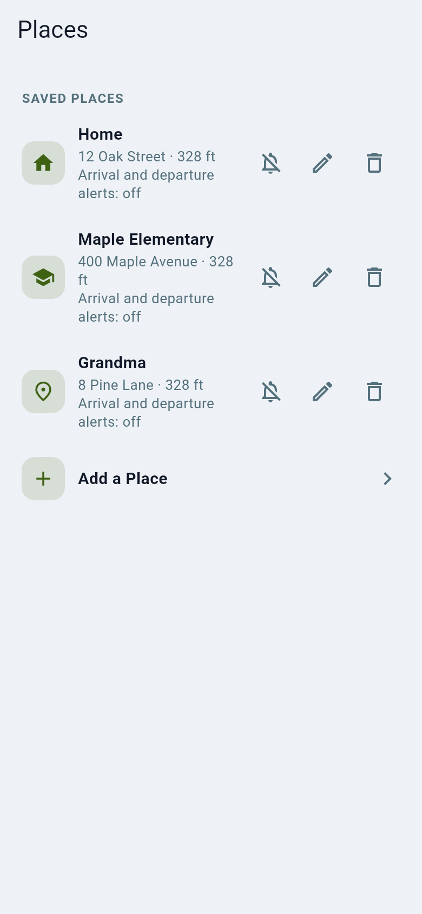

# Places and arrival alerts

A **place** is a spot you care about, such as Home, school or Grandma's. Add a
place and OpenFamily tells the circle when someone arrives or leaves.

1. Open **Places** and tap **Add a place**.
2. Search for an address or move the pin, then pick a radius.
3. Choose who is notified and for arriving, leaving or both.

Tips:

- Use a radius of at least 100 m so GPS drift does not cause false alerts. A
  fix with poor accuracy is ignored for alerts; see [Geofence accuracy](../geofencing.md).
- A **Bubble** is a temporary circle around where a person is right now (for
  example while they walk home); the person is told it exists. See [Bubbles](../bubbles.md).
- People who have paused sharing do not trigger place alerts.
