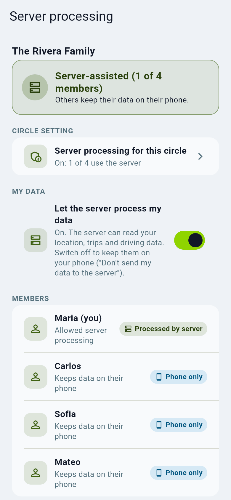
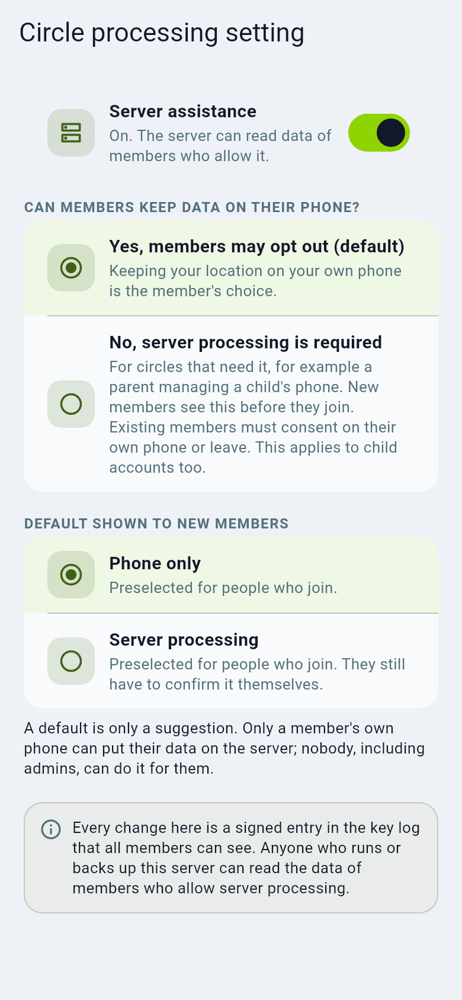

# Privacy modes explained

Each circle has a privacy mode. This page explains them without jargon: who can
see what, and what you give up for more privacy.

## The three modes

| Mode | In one sentence | The server can see your position? |
| --- | --- | --- |
| **Normal** | Your phone sends your position to the server, which shows it to your circle. | **Yes.** |
| **Private (phone-to-phone)** | Your position is locked on your phone and only the other phones in the circle can unlock it. | **No.** It stores locked data only. |
| **Server-assisted** (a Private circle where *you* allowed it) | Like Private, but your phone also gives the server a readable copy so it can do extra work for you. | **Yes, for you only.** |

### Normal

Simple and complete: the server draws the map, works out trips and weekly
driving reports, sends arrival alerts, and feeds the admin web and integrations
such as Home Assistant. The server's owner can in principle read the data.
Whether a *server admin* may look at members on the admin map is a separate
switch that is **off by default** (`ADMIN_LOCATION_ACCESS`); every look is
written to an audit log the circle can read.

### Private (phone-to-phone)

Positions are encrypted on your phone with a key the server never has. Other
members' phones decrypt them. A stolen database or a curious operator sees only
unreadable data and metadata (that you uploaded something, and roughly when).

What changes: the server cannot compute things from your data, so your phone
does it. Trips, driving reports and weekly summaries are calculated **on the
phone** and shared as results. Expect **more battery and CPU use** and some
features arriving later or only after the phone has run them. The admin web
can show a Private circle only if the signed-in person is a member and has
approved the browser from their phone.

> In the app's processing screens the phone-to-phone choice is labelled **Phone only** and the server-assisted choice **Processed by server** / **Let the server process my data**.

### Server-assisted

A person in a Private circle can choose to let the server help *for their own
data only*. Their phone then gives the server a readable copy. This restores
server features (admin map, server-side trips, Home Assistant) for that person.
Everyone else in the circle stays phone-to-phone.

## Who decides what

- The **circle admin** decides whether server help exists at all for the
  circle, and the default for new people.
  
- **Each person** decides for themselves, on their own phone. An admin cannot
  switch you on. You can **opt out at any time**: the server stops receiving new
  data and the app can delete copies the server already holds.
- If you are also in a **Normal** circle, that circle still sends your position
  to the server. Opting out applies per Private circle, and the screen tells you.

## What opting out does not hide

- That you are using the app and roughly when (the server sees that data was
  uploaded, its size and time).
- Anything already copied before you opted out, and old backups.
- Other members: a member who holds the circle key can read what the circle
  shares. Only add people you trust.

## Chat, sharing links and SOS

Chat is stored readable on the server (see [Chat](chat.md)). Share links are
for anyone with the link, until they expire. SOS messages work in every mode;
see [Safety](safety-and-check-ins.md).

## How to choose

- Server run by you at home and you want every feature: **Normal**, or
  Private with server help on a *home* server ([Deployment profile](../admin/deployment-profile.md)).
- Server rented from a hosting company, or someone in the family needs real
  privacy: **Private** circle, accept the battery cost.
- Technical background: [Privacy processing design](../design/PRIVACY_PROCESSING.md)
  and [Operator privacy controls](../privacy-controls.md).

## Which should I pick?

* **Normal (recommended).** Your server keeps locations so maps, history and driving reports just work.
* **Private.** Only phones can read locations; the server keeps nothing readable. Inside a Private circle
  each person then chooses **Use the server (recommended)** (reports, history and maps work for you) or
  **Keep on my phone** (shared privately, encrypted from phone to phone; no reports unless you turn on phone
  reports, which uses more battery). Nobody can choose for you, and you can change your mind any time.
* If a Private circle shows people missing because their app is old, a circle admin can **switch the circle
  to normal mode** so everyone shows up again. The server then keeps readable locations for that circle.
