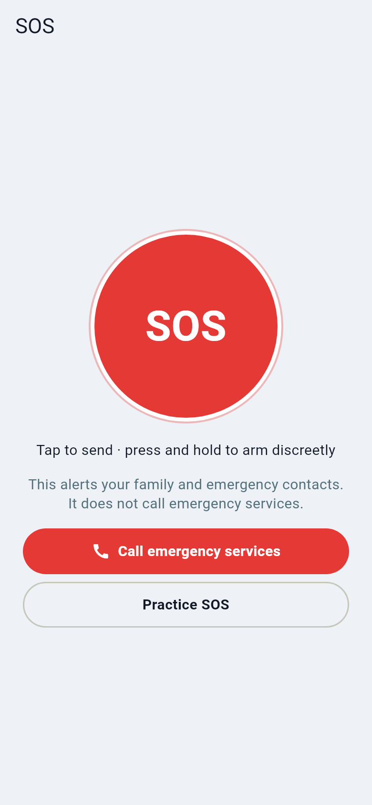
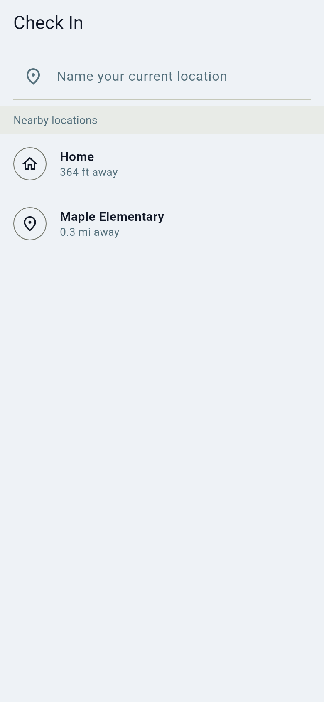

# Safety: SOS, check-ins and pausing

Orbitly tells **your family**. It never calls emergency services. If someone
is in danger, call your local emergency number first.

## SOS

Press the SOS button (hold to arm it discreetly). Your circle gets a
notification with your last position. If your server admin set up text
messages, your own emergency contacts get one too, with a temporary link and no
raw coordinates. Every SOS can be tried safely with **Practice SOS**.

No connection to the server? The SOS is kept on your phone, the screen says **SOS not sent yet**
and it is sent as soon as possible; you can also text your emergency contacts from your own
messages app. See [When the server is down](when-the-server-is-down.md).

## "I'm here" check-ins

Tell chosen people where you are with one tap. A check-in is an explicit act, so
it works even while you have paused sharing.

## Pause sharing

Need a break? Pause sharing for an hour, until tomorrow morning or a custom time.
Others see "Paused", not your position. The pause ends by itself. Your phone
keeps your own history; SOS always shares.

More: [Safety alerts](../safety.md), [Check-ins and temporary sharing](../checkin-sharing.md).
